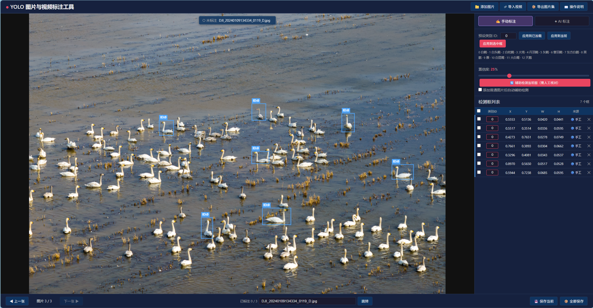
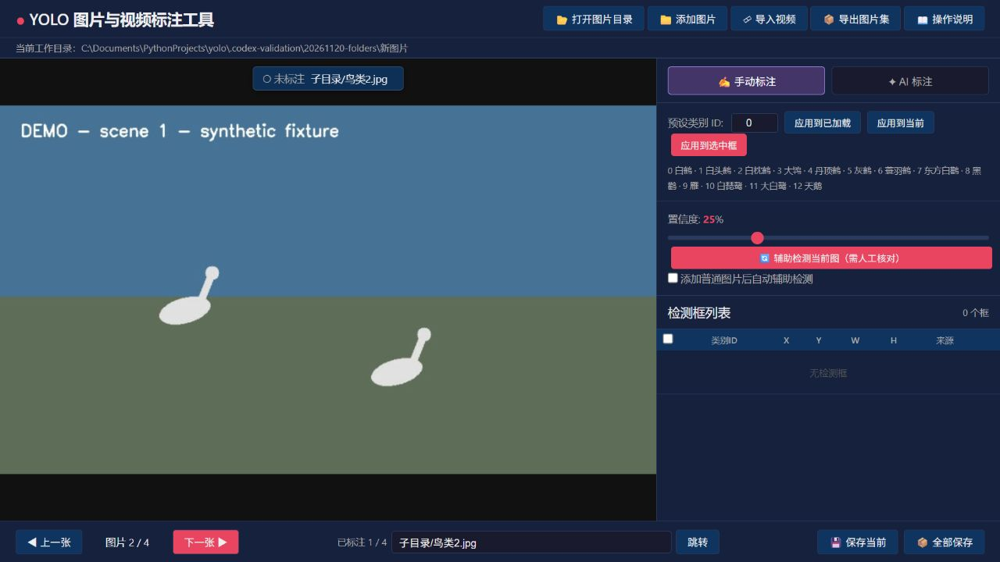
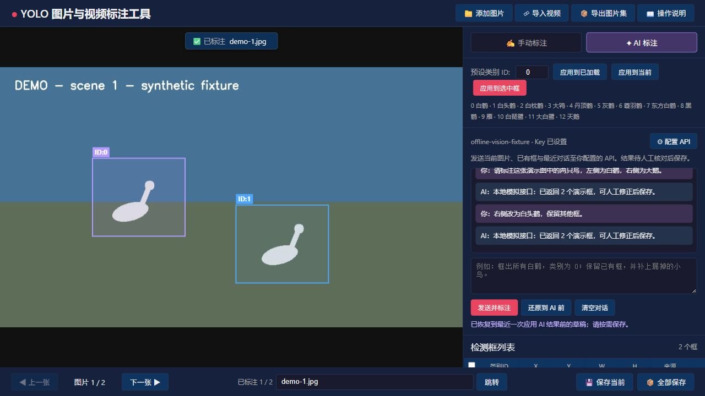

# YOLO Video Annotator · 图片与视频标注工具

一个在本机运行的网页标注工具，支持图片人工画框、视频抽帧、近似帧筛选、AI自动标注，以及标准 YOLO 检测标签导出。最初用于无人机鸟类数据制作，也可以通过修改类别表标注其他目标。

对于大量重复视角的视频，先抽帧筛选，再逐张人工标注，最后导出原分辨率图片与同名 TXT。手工标注、抽帧和导出均不需要 GPU 或检测模型；YOLO 辅助检测按需启用。




## 功能

- **图片标注**：导入图片、手工画框、修改类别、批量操作、缩放和平移。
- **页面打开目录**：浏览磁盘、进入子目录，打开整个图片文件夹；可包含子目录并读取已有标签。
- **视频标注**：批量导入本机视频或目录，支持指定时间范围与抽帧间隔。
- **近似帧筛选**：结合感知哈希、整体像素差与局部像素差，减少重复画面。
- **后台抽帧**：显示候选数、筛除数和保留数，可停止任务并保留已提取帧。
- **标注持久化**：刷新或重启后读取已有标签，支持明确保存无目标空标签。
- **YOLO 辅助检测**：生成候选框后人工核对；模型仅在使用时加载。
- **自然语言 AI 标注**：配置自己的视觉模型 API，通过侧栏对话标注当前图片，再人工修正和保存；后台等待、流式进度与刷新恢复可用于耗时较长的图片。
- **数据集导出**：下载原图、YOLO TXT、类别表与视频来源清单。
- **按视频分组划分**：可生成 `train/val` 及 `data.yaml`，同一视频不会被拆到两个分区。

## 快速开始

需要 **Python 3.10 或更高版本**。建议创建独立虚拟环境。

### Windows PowerShell

```powershell
git clone https://github.com/Bai-clou/yolo-video-annotator.git
cd yolo-video-annotator
python -m venv .venv
.\.venv\Scripts\python.exe -m pip install -r requirements-annotation.txt
.\.venv\Scripts\python.exe label_app.py
```

### Linux / macOS

```bash
git clone https://github.com/Bai-clou/yolo-video-annotator.git
cd yolo-video-annotator
python3 -m venv .venv
.venv/bin/python -m pip install -r requirements-annotation.txt
.venv/bin/python label_app.py
```

启动后打开 **<http://127.0.0.1:5000>**，点击 **打开图片目录 → 选择文件夹 → 打开目录**，即可开始标注。不加 `--source` 时，初始工作目录为程序目录；也可用 `--source ./annotation_workspace` 指定初始目录，不存在时自动创建。视频在页面中导入。服务只监听本机，关闭服务请在启动终端按 `Ctrl+C`。

如果已有可用 Python 环境，也可以直接安装依赖并运行：

```bash
python -m pip install -r requirements-annotation.txt
python label_app.py
```

## 在页面中选择目录

- **图片目录**：顶部点击 **打开图片目录**，在页面内的文件夹浏览器中选择磁盘、返回上一级或点击子目录，再点 **选择此目录 → 打开目录**。也可以直接粘贴本机目录路径。
- **包含子目录**：默认勾选；所有图片按相对路径列出，子目录中的同名图片不会混淆。不勾选则只读取当前层。点号开头的目录、`env/venv`、`__pycache__` 与视频工作区不会作为普通图片重复扫描；保留的视频帧仍会单独加载。
- **原位标注**：打开目录不会复制图片，直接读取已有同名 TXT 或数字类别子目录中的标签。新标签继续按原有规则保存在各图片所在目录；打开新目录后，不沿用启动时的 `--output` 目录。
- **切换保护**：有未保存修改时，点击 **保存全部并打开**；保存失败会留在原目录。请先等待或停止当前页面的抽帧/AI 任务，再切换目录。
- **视频目录**：点击 **导入视频 → 添加视频目录**，同样使用页面内的文件夹浏览器；可多次添加多个目录，目录内及其子目录的视频会一起抽帧。

页面顶部显示当前工作目录，后续单文件上传、视频抽帧、AI 配置和导出均使用这个目录。当前浏览器会话内刷新可继续使用所选目录；服务重启后回到启动目录，可再次在页面选择。完整对话和未保存草稿仍遵循原有刷新规则，切换前请保存。



*截图使用合成素材，展示整目录加载和当前工作目录，不代表模型识别效果。*

## 标注流程

```text
图片 ────────────────────────────────┐
                                    ↓
视频 → 间隔抽帧 → 筛除近似帧 → 人工画框/核对类别 → 保存 → 导出图片集
```

1. 点击 **打开图片目录** 加载整个文件夹，点击 **添加图片** 上传一个或多个文件，或点击 **导入视频**。
2. 视频可点击 **添加视频目录**，或填写本机文件/目录路径，每行一个；目录递归查找视频。也可通过文件选择器上传多个视频。目录与路径导入无需复制一份原视频。
3. 设置间隔和去重参数，点击 **开始抽帧**。完成后关闭弹窗，保留帧进入图片列表。
4. 拖拽空白处画框，修改类别 ID；对辅助检测产生的框逐个核对、补框或删除。
5. 点击 **保存当前** 或 **全部保存**。确认当前图片没有目标时，可以保存空 TXT。
6. 点击 **导出图片集**。只有已保存的图片及标签进入 ZIP；尚未标注的帧不会自动成为背景样本。

视频帧显示原视频时间与从 **0** 开始的帧号。停止抽帧后，已经提取的图片仍可标注。关闭浏览器不会停止后台任务；关闭服务会中断任务，重启后保留图片和标签，但不会自动续跑抽帧。

### 常用操作

| 操作 | 方式 |
|---|---|
| 手工画框 | 在画面空白处拖拽 |
| 选中框 | 单击框或表格行 |
| 多选 | Shift 单击框，或表格勾选 |
| 缩放 | 鼠标滚轮，以鼠标位置为中心 |
| 平移 | 右键/中键拖动，或空格＋左键 |
| 恢复视图 | 双击画布 |
| 删除框 | Delete / Backspace |
| 撤销最近的手工框 | Ctrl+Z |
| 上一张 / 下一张 | ← / →，或 P / N |
| 保存当前 | Ctrl+S |
| 跳转 | 输入图片序号或文件名 |

## 视频去重设置

| 参数 | 默认值 | 说明 |
|---|---:|---|
| 抽帧间隔 | 2 秒 | 按时间间隔产生候选帧 |
| 筛除近似帧 | 开启 | 关闭后保留所有间隔采样候选 |
| 哈希距离上限 | 6 | 越小越严格，保留越多 |
| 平均像素差上限 | 3 | 灰度像素差平均值，越小保留越多 |
| 局部像素差上限 | 10 | 局部区域差异上限，越小保留越多 |
| 最长保留间隔 | 30 秒 | 相似场景也定期保留一个候选；0 关闭此规则 |
| 开始 / 结束时间 | 0 / 视频结尾 | 结束时间不包含在处理范围内 |
| 每视频最多保留帧数 | 0 | 0 不限，达到上限后停止该视频 |

每个候选只与**同视频的上一张保留帧**比较，三项相似条件都满足才跳过；没有跨视频的近似画面去重。同一批导入中，内容完全相同的视频文件只处理一次。

比较使用最长边不超过 640 像素的灰度缩略图，保存的是**原分辨率 JPG（质量 95）**。程序顺序读取视频，不会先把全部帧保存到磁盘。

去重判断的是画面相似度，不能保证保留所有有用的目标姿态。远处小鸟、遮挡变化或细微动作可能被忽略；可以降低阈值、缩短抽帧间隔，或关闭去重。相机运动、光线和水面变化也可能使更多帧被保留。建议先在短片段上查看筛选效果，再批量处理。

## 类别与 YOLO 标签

默认 `classes.json` 使用以下 13 个鸟种：

| ID | 类别 | ID | 类别 |
|---:|---|---:|---|
| 0 | 白鹤 | 7 | 东方白鹳 |
| 1 | 白头鹤 | 8 | 黑鹳 |
| 2 | 白枕鹤 | 9 | 雁 |
| 3 | 大鸨 | 10 | 白琵鹭 |
| 4 | 丹顶鹤 | 11 | 大白鹭 |
| 5 | 灰鹤 | 12 | 天鹅 |
| 6 | 蓑羽鹤 | | |

可用 `--classes ./my_classes.json` 指定其他类别。格式是名称到连续整数 ID 的映射，ID 从 0 开始：

```json
{
  "类别 A": 0,
  "类别 B": 1
}
```

标签使用标准 YOLO 检测框的五列格式：

```text
class_id center_x center_y width height
```

中心坐标与宽高均相对图片尺寸归一化到 0–1。空 TXT 表示人工确认的无目标样本。整张训练图片中的目标应完整标注，避免把遗漏目标作为背景。

## 自然语言 AI 标注

1. 在侧栏点击 **AI 标注 → 配置 API**。
2. 填写支持图片输入的模型 ID、API 地址和自己的 Key，选择 **Chat Completions（OpenAI 兼容）** 或 **Responses**。
3. 点击 **测试连接并保存**；测试发送生成的白色图片，不发送当前工作图。
4. 输入需求，例如“框出所有白鹤，类别为 0，保留已有框并补全漏标”，点击 **发送并标注**。
5. 检查返回的紫色框，修改类别、选中框修正坐标，或删除重画，再保存和导出。

AI 会结合本图最近对话和当前已有框处理后续要求。结果是未保存草稿，可还原到最近一次 AI 应用前；等待期间切换图片或修改草稿，不会自动串图或覆盖新修改。

Key 仅留在服务进程内，重启后需重填；非密钥配置保存在工作目录的 `.ai-config.json`，已加入忽略规则。正式标注会发送当前图片和需求至所配置的 API，可能产生服务商用量。密集小目标的定位仍需人工复核。



*合成图片与本地模拟接口的流程演示，不代表真实模型准确率。*

支持范围、参数与错误排查见 [AI 标注配置说明](docs/AI_ANNOTATION.md)。

## 导出与训练划分

默认导出尚未划分的图片集：

```text
images/                  # 原图片及原分辨率视频帧，无绘制的标注覆盖层
labels/                  # 与图片同名的 YOLO TXT
classes.json
classes.txt
source_manifest.jsonl    # 来源视频、帧号、时间点、图片与标签对应关系
README.txt
```

勾选 **按来源视频划分训练/验证集** 后导出：

```text
images/train/
images/val/
labels/train/
labels/val/
data.yaml
classes.json
classes.txt
source_manifest.jsonl
README.txt
```

- 验证比例按**来源分组数**计算，并非精确的图片数量比例。
- 同一视频的全部帧进入同一分区，至少需要两个独立来源才能划分。
- 以完整视频文件的 SHA256 分组，改名、重复上传或重复导入的相同视频仍归为同组。
- 每张普通图片作为一个独立分组。不同文件若拍摄同一场景或连续鸟群，仍需人工按拍摄场次/地点进一步划分。
- 未划分导出不生成 `data.yaml`；已划分导出包含相对路径配置，可解压到其他位置使用。

导出数据可用于 YOLO 等接受相同检测标签格式的训练流程。ResNet 分类训练仍需按框裁剪图片，或由分类数据加载器在线裁剪。

## 启动参数与辅助检测

```bash
python label_app.py --help
python label_app.py --source ./annotation_workspace --port 5001
python label_app.py --source ./annotation_workspace --classes ./my_classes.json
python label_app.py --source ./annotation_workspace --model ./weights/your_model.pt
```

| 参数 | 说明 |
|---|---|
| `--source` | 图片与抽帧工作目录，默认脚本所在目录 |
| `--output` | 普通图片标签输出目录；视频帧使用批次内的 `images/labels` |
| `--classes` | 自定义类别 JSON，默认仓库内 `classes.json` |
| `--model` | 辅助检测权重，默认仓库根目录的 `yolo26x.pt` |
| `--port` | 本机服务端口，默认 5000 |

辅助检测另需安装 Ultralytics 及兼容的 PyTorch 环境，并自行准备可加载的模型权重：

```bash
python -m pip install ultralytics
```

仓库不包含权重。手工标注无需安装以上可选依赖。当前辅助检测会将候选框统一赋为页面预设类别 ID，**不会自动识别为这 13 个鸟种**；需要人工确认类别、删除非目标框并补全漏框。

## 项目结构与测试

```text
label_app.py                   # Flask 页面与标注、视频任务、导出 API
ai_annotation.py               # 视觉 API 适配、会话 Key 与标注结果校验
ai_jobs.py                     # 后台 AI 任务、状态恢复与取消
static/ai_annotation.js         # AI 对话、草稿应用与坐标修正
static/directories.js           # 图片工作目录切换与视频目录选择
video_frames.py                # 视频采样、近似帧筛选与分组导出
templates/index.html           # 标注界面与画布操作
classes.json                   # 默认鸟种映射
requirements-annotation.txt    # 基础依赖，不包含模型运行环境
tests/test_video_annotation.py # 抽帧、标签、导出与分组测试
tests/test_ai_annotation.py    # 视觉 API 协议、Key 与错误处理测试
tests/test_ai_jobs.py          # 后台进度、刷新恢复、取消与防重复请求
tests/test_directories.py      # 目录浏览、递归加载、保存隔离与视频目录导入
docs/images/annotation-demo.jpg
VIDEO_ANNOTATION.md            # 详细操作与保存目录说明
```

```bash
python -m unittest discover -s tests -v
```

测试使用临时目录和合成视频，不加载检测权重。覆盖抽帧间隔、去重开关、时间范围、保留上限、视频内容指纹、取消、标签保存/读回、空标签、后台导入、导出配对与分组划分。辅助检测准确率不属于这些测试的验证范围。

图片、视频、权重、工作区和本地运行记录已加入 `.gitignore`。更详细的保存目录与操作说明见 [VIDEO_ANNOTATION.md](VIDEO_ANNOTATION.md)。
