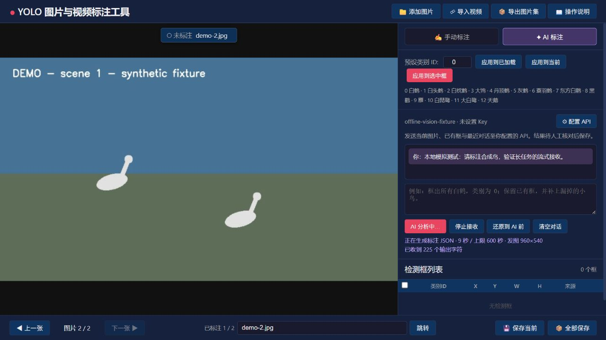

# 自然语言 AI 标注

侧栏选择“AI 标注”，可以用自然语言要求视觉大模型在当前图片上标注、补框、删除或改类别。结果进入可人工编辑的画布，确认后再保存为原有 YOLO 标签。

## 配置与测试

1. 启动 `label_app.py`，打开图片或已经抽出的保留帧。
2. 切换到 **AI 标注 → 配置 API**。
3. 填写接口类型、API 地址、视觉模型名称/模型 ID 和自己的 Key。
4. 点击 **测试连接并保存**。测试发送一张生成的 32×32 白色图片，显示请求结果和模型回复，不使用当前工作图片。
5. 关闭配置窗，输入标注需求，点击 **发送并标注**，或按 `Ctrl+Enter`。

连接测试与正式标注都会调用服务商 API，可能产生用量。连接成功表示图片请求已经通过，不等于模型具有准确定位能力；实际框选需要人工核对。

## 支持范围

| 类型 | 地址示例 |
|---|---|
| Chat Completions | `https://你的服务域名/v1` 或完整 `/chat/completions` 地址 |
| Responses | `https://你的服务域名/v1` 或完整 `/responses` 地址 |

填写根地址会补 `/v1`，已有 API 路径则在其后补接口后缀；完整地址直接使用，自定义路径前缀与查询参数会保留。地址不能包含 Key，请在单独的密钥框填写。接口类型与后缀不一致时会提示修改。

需要支持图片输入的模型。可使用提供相同协议的第三方网关或本地服务，无 Key 的服务可以留空。原生 Anthropic Messages、Gemini `generateContent` 等请求协议尚未实现，应填写服务商提供的 OpenAI 兼容地址，不要填写聊天网页地址。

协议参考官方文档：[图像输入](https://developers.openai.com/api/docs/guides/images-vision)、[Responses API](https://developers.openai.com/api/reference/resources/responses/methods/create)、[多轮对话](https://developers.openai.com/api/docs/guides/conversation-state)。

## 对话与人工修正

```text
框出所有白鹤，类别为 0，保留已有框，补全漏标的小鸟。
把右侧第二只鸟改为白头鹤，其他框保持不变。
删除水面倒影对应的框，只保留真实的鸟。
解释有哪些目标不确定，暂时不要修改标注。
```

- 每张图片的对话独立，发送本图最近 12 条用户/AI 消息，以及当前实际的已有框与类别表。
- 图片和草稿在等待期间均未改变时，结果自动应用为**未保存草稿**。
- 若切换了图片或手工修改了草稿，结果只返回原图，并显示 **应用本次结果**；不会覆盖另一张图或期间修改的草稿。
- AI 返回操作后的完整框集合，“应用本次结果”会更新本图全部框。
- **还原到 AI 前** 恢复最近一次应用结果前的草稿，包括之后的修改也会一并恢复；需要再次保存才写入 TXT。
- 点击框或表格行选中目标，可修改类别、删除重画，也可在“选中框坐标修正”里修改归一化中心点与宽高。
- AI 框显示紫色；手工改单个类别或坐标后显示为手工框。
- AI 不直接写标签文件，仍需点击 **保存当前/全部保存**，再使用原有导出功能。

完整对话只在当前浏览器页面内存中，刷新后清空；后台恢复会带回该任务的指令和结果。已经保存的 YOLO 标签会保留。

## 复杂图片与长时间等待

标注请求在后台运行，页面每秒查询状态，显示已用时间、发图尺寸以及收到的分析/输出字符数。字符数表示模型仍在响应，不是完成百分比；不展示模型的思考原文。关闭流式接收时仍可使用后台任务，但通常只能看到等待状态。



*合成图片与本地模拟接口的演示截图，用于展示进度界面，不代表真实模型定位效果。*

- 默认等待上限为 **600 秒**，可在高级设置中改为 **5–1800 秒**。原有工作目录中的自定义超时设置会保留，请检查自己的设置。
- 刷新或关闭页面不会重新提交模型请求。同一服务进程仍在运行时，重新打开页面会恢复等待；恢复的结果需要点击 **应用本次结果**，不会自动覆盖草稿。
- 完整结果在服务器内存中暂存，应用后仍需 **保存当前/全部保存** 才会写入标签。刷新前未保存的手工修改仍会丢失；后台结果可以恢复，整个编辑草稿不在此范围内。
- 状态查询失败时可点击 **恢复等待**；程序只重查状态，不自动重试模型请求，避免重复用量。
- **停止接收** 会丢弃该任务的结果，不应用迟到结果，但不能保证服务商立即停止计算或计费。
- 重启服务会丢失内存中的任务、未保存结果和 Key；已保存的图片与标签保留。请先保存需要的结果。

复杂图的模型分析和大量框输出可能超过等待上限。优先延长等待；仍超时时，可按区域或物种分批要求标注，并在后续请求中说明保留已有框。降低发图尺寸可减少图像输入，但也可能漏掉密集小鸟，不保证一定更快。

只有收到完整结束事件并通过 JSON、类别和坐标校验的结果才能应用。断流、超时或输出被截断时，不会把已经收到的部分 JSON 当成标注，也不修改已有框。

### 输出 Token 被截断

这与请求超时不同：服务商以 `length` / `max_output_tokens` 等原因结束输出，标注 JSON 可能尚未生成或只生成了一部分。思考模型的分析可能占用同一输出预算；图片目标多时，完整框集合也会消耗较多 Token。

默认输出额度已提高到 **32768**。已有目录中的自定义额度仍保留，可点击截断提示旁的 **调整输出额度**，直接展开高级设置并填入建议值（8192 → 32768，32768 → 65536，工具最多允许 131072）。请确认模型支持该额度，保存配置后重新发送原需求；程序不会自动重发，也不会应用部分结果。

新增 **思考深度**：自动模式只对智谱官方 `open.bigmodel.cn` / `api.z.ai` 的 GLM-5.3 系列 Chat 接口使用 `low`，其他模型沿用服务商默认。可选择“服务商默认”取消该优化，或指定模型支持的深度。GLM-5.3-Flash 不能关闭思考，深度取值为 `low/high/max`；复杂任务可提高深度并相应增加额度。参见 [官方模型说明](https://docs.bigmodel.cn/cn/guide/models/vlm/glm-5.3-flash) 和 [官方思考深度说明](https://github.com/zai-org/GLM-5#note)。

提高上限可能增加耗时和实际用量，不能保证密集图片一次完成。仍被截断时，可按区域或物种分批要求标注，并明确保留已有框。提示中的分析/输出字符数用于诊断，不是 Token 用量。

## Key 与配置保存

非密钥配置写入 `--source` 工作目录的 `.ai-config.json`。Key **只在当前服务进程内保存**，不写配置文件、不写浏览器存储、不回传配置查询、不进入导出数据或 Git 提交。关闭服务后需要重新填写；仅刷新网页仍可使用当前进程中的 Key。

同一地址留空 Key 沿用本次运行的 Key；更改请求地址或 Key 请求头类型时，不会把旧 Key 自动发给新地址，请重新填写。可勾选“清除已保存的会话 Key”后保存。Key 通过请求头发送，不放入模型对话内容；请不要在自然语言对话里粘贴密钥。

正式标注会发送当前图片和需求至用户配置的 API，服务商的数据处理策略由该服务商决定。

## 高级设置

| 参数 | 默认值 | 用途 |
|---|---:|---|
| Key 请求头 | Authorization: Bearer | 也可使用 `api-key` |
| 最大输出 Token | 32768 | 工具允许 256–131072，以模型实际支持为准；截断结果不应用 |
| 思考深度 | 自动优化 | 官方 GLM-5.3 Chat 使用 low，其余沿用服务商默认；也可显式指定支持的深度 |
| Chat Token 参数 | 自动 | 官方 OpenAI 域名使用 `max_completion_tokens`，其他地址用 `max_tokens`；可手动覆盖 |
| 等待上限 | 600 秒 | 可设 5–1800 秒；程序不自动重试模型请求 |
| 流式接收 | 开启 | 显示模型响应进度；接口不兼容时可关闭 |
| 发图最长边 | 2048 像素 | 等比缩放；0 原尺寸，最大可设 8192 |

发送时校正 EXIF 方向并转为 JPEG，不修改原图片。返回坐标相对整张图片归一化，仍对应原分辨率。密集小目标可增大发图尺寸，同时会增加传输和模型用量。

401/403 通常应检查 Key 和模型权限；404 检查地址与模型 ID；400 检查图片输入、协议和 Token 字段；429 检查限流和额度。输出截断、无效 JSON、未知类别、无效坐标或越界框时，本次结果不应用，已有标注保持不变。

模型被要求返回 0–1 归一化的 YOLO 框，不接受像素或 0–1000 坐标。通用视觉模型仍可能漏标、错分类或框不准，尤其是密集小鸟，训练前应人工核对整张图。

开发验证使用合成素材与本地模拟视觉接口，覆盖协议、错误处理与页面操作，没有验证真实付费模型的准确率。
